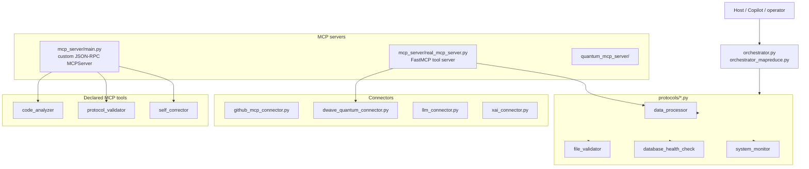

# Repo Map, MCP Verification, and Agent Workflow Checklist

This repository mixes agent orchestration, MCP servers, connectors, protocols,
and a small frontend. This document makes the issue's requested "repo assist"
material specific to `groupthinking/self-correcting-executor` so an agent can
map the repo, verify the MCP handler in-process, and decide what to check before
commit/merge.

## Repo tree (focused map)

```text
self-correcting-executor/
├── agents/                  # A2A framework, executor, mutator, MCP integrations
│   ├── a2a_framework.py
│   ├── a2a_mcp_integration.py
│   ├── executor.py
│   ├── mutator.py
│   ├── specialized/
│   └── unified/
├── analyzers/               # Pattern analysis helpers
├── auth/                    # Auth helpers
├── config/                  # MCP and component configuration
├── connectors/              # D-Wave, GitHub, LLM, xAI, MCP base connectors
├── docs/                    # Architecture, planning, and task guides
├── fabric/                  # State continuity and integrated MCP fabric
├── frontend/                # Vite + React UI
├── llm/                     # Continuous learning system
├── mcp_runtime_template_hg/ # SDK/API/CLI MCP runtime template
├── mcp_server/              # JSON-RPC MCP server + FastMCP-backed server
├── middleware/              # Security middleware
├── protocols/               # Executable protocols/tasks
├── quantum_mcp_server/      # Quantum-focused MCP server variant
├── scripts/                 # Setup, compliance, cleanup, security scripts
├── test_data/               # Real input fixtures used by tests/scripts
├── tests/                   # Pytest suite
├── ui/                      # Additional UI assets and guide content
└── utils/                   # Shared logging and DB tracking
```

## Dependency snapshot

- Python runtime dependencies: `requirements.txt` currently pins **117**
  packages, including `mcp`, `mcp-use`, FastAPI, D-Wave Ocean SDK, LangChain,
  SQLAlchemy, Redis, and transformer-related packages.
- CI/test dependencies: `requirements-ci.txt` contains the lightweight
  verification stack (`black`, `flake8`, `pytest`, `pytest-cov`,
  `pytest-asyncio`) plus the MCP, NumPy, and PostgreSQL imports needed by
  the collected tests. MCP/Pydantic match the production compatibility pair.
- Frontend runtime dependencies: `frontend/package.json` currently declares
  **7** runtime packages (`react`, `react-dom`, `@tanstack/react-query`,
  `axios`, `framer-motion`, `lucide-react`, `three`) and **12** dev
  dependencies for TypeScript, ESLint, and Vite.

## Mermaid diagram



The MCP servers are separate entrypoints; no direct orchestrator-to-server
call is implied. `real_mcp_server.py` imports the D-Wave connector and the
data processor. Other connectors are shown as repository components, not
as dependencies of that server.

## Agentic workflow checklist for this repo

- [x] **Agents**: `agents/a2a_framework.py`, `agents/a2a_mcp_integration.py`,
      and `agents/unified/` contain agent coordination logic.
- [x] **Tools**: `mcp_server/main.py` declares `code_analyzer`,
      `protocol_validator`, and `self_corrector`.
- [x] **MCP**: the repo is actively using MCP packages and MCP-shaped servers
      (`mcp_server/main.py`, `mcp_server/real_mcp_server.py`,
      `config/mcp_config.py`, `connectors/mcp_base.py`).
- [x] **Pull / push / request / commit / merge**: human workflows use GitHub
      pull requests; cloud-agent workflows in this repo should publish progress
      via PR updates instead of pushing directly from the sandbox.
- [x] **Issues**: link changes back to GitHub issues with `Closes #<number>`.
- [x] **Code**: the main test entrypoint is `pytest` with `pytest.ini`
      configured to use `tests/`.
- [x] **Deps**: Python dependencies live in `requirements*.txt`; frontend
      dependencies live in `frontend/package.json`.
- [x] **Database**: DB-aware execution paths are visible in `utils/db_tracker.py`
      and `protocols/database_health_check.py`.
- [x] **Actions**: `.github/workflows/python-ci.yml` and
      `.github/workflows/frontend-ci.yml` define CI.
- [x] **Role assignment / security**: `auth/` and `middleware/` contain auth
      and security logic.

## MCP baseline: is this repo using MCP?

Yes. The repository is using MCP in two forms:

1. A custom JSON-RPC server in `mcp_server/main.py`
   with explicit MCP methods such as `initialize`, `tools/list`, `tools/call`,
   `resources/list`, and `resources/read`.
2. A FastMCP-based server in `mcp_server/real_mcp_server.py`
   built on the `mcp` package.

The custom handler advertises protocol version `2024-11-05`. Direct calls
can verify its advertised tool and resource behavior, but do not establish
MCP specification compliance or successful transport negotiation with an
external host/client. Those require a separate integration test.

### Host / client / server mapping for this repo

- **Host**: external agent host (for example Copilot, CLI, or another MCP-aware
  operator) orchestrates requests and permissions.
- **Client**: the MCP-aware caller is external to this repo; this repo does not
  ship a standalone client implementation.
- **Server**: this repo implements the server side in `mcp_server/` and
  `quantum_mcp_server/`.

## Live verification steps

The focused verifier calls the custom handler in-process. It asserts the
initialize response, the advertised/listed tool names, and the actual
`code_analyzer` result. Any JSON-RPC error, missing capability or incorrect
analysis raises an exception and makes the command exit unsuccessfully.
This proves the handler behavior, not an external MCP transport connection.

From any directory inside the checkout:

```bash
cd "$(git rev-parse --show-toplevel)"
python -m scripts.verify_mcp_baseline
python -m pytest tests/test_repo_assist_docs.py tests/test_mcp_baseline_verifier.py -q
```

## CI baseline observed from GitHub Actions

- The repo has active `Python CI` and `Frontend CI` workflows.
- `Python CI` runs `black --check .` as a blocking step. Inspect the current
  head's logs; a previous run's result is not evidence for a new commit.
- `pytest --cov=.` is blocking: collection failures and failed assertions fail
  the matrix job. `flake8` remains advisory in the existing workflow, so a
  green workflow alone does not prove the repository is free of lint findings.

## Skills added for this repo

Project-scoped skills now live under `.github/skills/`:

- `github-actions-failure-debugging`: tailored to the repo's Python/Frontend CI
  workflows and GitHub MCP debugging flow.
- `codebase-summary`: tailored to this repo's tree mapping, dependency checks,
  and MCP verification workflow.
